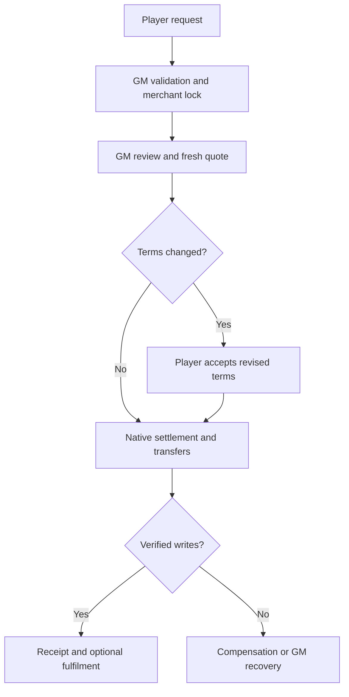

# Architecture

**Audience:** developers and maintainers. **Purpose:** explain state ownership, component boundaries and failure handling.

## State ownership

| Layer | Authoritative storage |
| --- | --- |
| Products, catalogue metadata, profiles, services and presets | Versioned JSON under `data/` |
| Generated reusable Items and stock tables | World compendiums generated from source |
| Merchant stock and cash | NPC embedded Items and native `system.currency` |
| Business configuration and per-character memory | `flags.devils-table.merchant` on the NPC |
| Final decisions and interrupted-trade checkpoints | GM-only transaction JournalEntry compendium |
| Room access leases | GM-only world booking Journals |
| Native name, portrait, species, biography and token identity | Foundry/D&D5e Actor and Token fields |

Saved collection IDs are in `scripts/core/compendium-names.js`; display names do not redefine identity. Source-derived document IDs and append-only ledgers preserve UUIDs. Imports/Actor copies are independent of later compendium rebuilds.

## Components

| Directory | Responsibility |
| --- | --- |
| `scripts/catalogues/`, `scripts/data/` | Provider metadata, source loading and selection |
| `scripts/validation/`, `schemas/` | Structural and semantic authoring constraints |
| `scripts/builders/`, `scripts/stock/` | Deterministic conversion, reconciliation and stock sampling |
| `scripts/merchant/` | Projection, pricing, review, settlement, transfers, receipts and recovery |
| `scripts/merchant/builder/`, `scripts/apps/`, `scripts/ux/` | Native application entry points and editable previews |
| `scripts/services/` | Definitions, offerings, eligibility, required Items and optional fulfilment |
| `scripts/integrations/` | Adapter registration, capabilities, booking lifecycle and external writes |

## Startup and extensions

At `init`, the module registers settings/entry hooks and exposes its API. Providers register synchronously during `setup`. At `ready`, validated metadata/services initialise, compendium display names are applied and shop/booking hooks begin. Failed catalogue initialization does not start a partly registered merchant service. See [Public API](API_REFERENCE.md) for the supported boundary; direct source imports and internal classes are not extension contracts.

## Trading lifecycle

Browse requests do not reserve stock or write relationship visits. Checkout confirms requester ownership/identity, resolves the current merchant and character, validates stock/services and uses active-GM coordination. The service slot serializes competing decisions for one merchant. GM revisions require player consent. Approval recalculates authoritative terms before payment.

Native writes have read-back verification and compensating steps; they are not a transaction spanning Foundry documents. An interrupted/conflicting operation retains recovery evidence rather than silently replaying payment. Direct edits by other GMs/modules remain outside these guards.

## Projection and restricted offers

The GM sends an allowlisted public catalogue, offers, presentation and numeric pricing terms. Actor biography, private notes/tags, raw relationship records, DCs, service actions/UUIDs, door mappings and recovery data stay private. Module JSON and shared compendiums are reference content, not a secret store.

`merchant/visibility.js` evaluates public, hidden and relationship offers for stock and services before browse, checkout and theft. Relationship access counts this character's successful purchases. Missing policies retain public behaviour; invalid policies fail closed. Native transfers strip merchant offer controls from customer Items. See [Merchant Data Model](MERCHANT_DATA_MODEL.md).

## Services and integrations

Services join the existing basket/review/payment pipeline. Item-required services identify one compatible customer Item and do not consume or modify it automatically. Ordinary built-in commissions are recorded for GM fulfilment.

Optional actions run after durable settlement, with an attempted marker before side effects. Missing adapters skip safely; failures require inspection rather than automatic replay/refund. Integration writes are serialized across merchants; client presentation cannot reach GM actions. Booking leases persist separately from receipts so retention/reset cannot orphan active access. See [Merchant Services](MERCHANT_SERVICES.md) and [Integration Developers](INTEGRATION_DEVELOPERS.md).

## Related documents

[Project Philosophy](PROJECT_PHILOSOPHY.md), [Developer Guide](DEVELOPER_GUIDE.md), [Testing](TESTING.md), [Known Limitations](KNOWN_LIMITATIONS.md).
